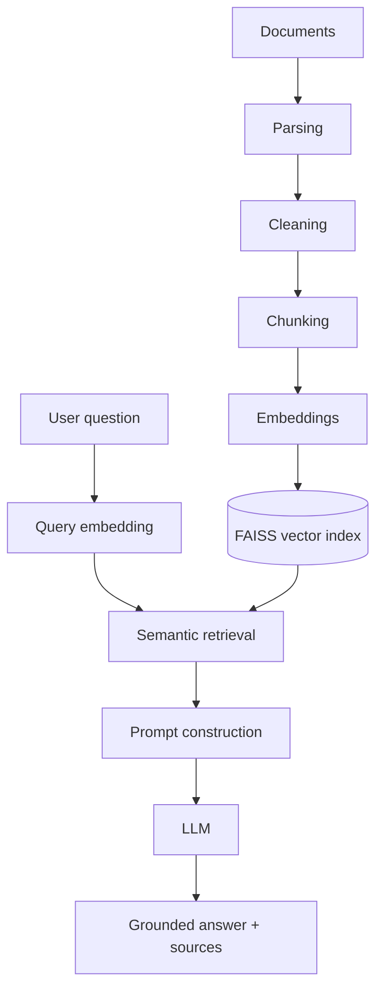

# Enterprise AI Knowledge Assistant

**Retrieval-Augmented Generation and Intelligent Document Analysis**

> 🚧 Work in progress — built incrementally, phase by phase.

## Problem

Organizations keep their knowledge in many documents (PDF reports, policies, manuals,
meeting notes). Keyword search misses meaning and cannot synthesize answers across files.
This project builds an assistant that ingests documents, retrieves the relevant passages
by semantic meaning, and answers questions with an LLM **grounded only in those sources —
with citations users can verify**.

## Planned architecture



## Tech stack

Python 3.11+ · sentence-transformers (bi-encoder + cross-encoder) · FAISS · FastAPI ·
Streamlit · OpenAI-compatible LLM API / Ollama · PyTest · Docker · GitHub Actions

## Quick start (Windows)

```powershell
py -3.11 -m venv .venv
.venv\Scripts\Activate.ps1
python -m pip install --upgrade pip
pip install -r requirements.txt
copy .env.example .env
python scripts/check_environment.py
pytest
```

`pytest` runs the fast unit tests only. Tests that load real ML models are marked
`integration` (the first run downloads the embedding model, ~90 MB):

```powershell
pytest -m integration
```

## Usage

```powershell
# 1. Put PDF / TXT / MD files in data\documents, then build (or update) the index
python scripts/build_index.py
# 2. Inspect retrieval only (no LLM)
python scripts/search.py "How many leave days do I get?"
# 3. Ask for a cited answer (needs OPENAI_API_KEY in .env, or LLM_PROVIDER=ollama)
python scripts/ask.py "How many leave days do I get?" --show-sources
```

### Web app (API + chat UI)

Run each in its own terminal from the project root (venv activated):

```powershell
uvicorn app.main:app                  # API on http://127.0.0.1:8000  (docs: /docs)
streamlit run ui/streamlit_app.py     # UI  on http://127.0.0.1:8501
```

Both listen on this computer only. The UI can upload/delete documents, filter by
file, and has a *Find passages only* mode that works without an LLM key.

Questions the documents cannot answer return *"I could not find the answer…"*;
when retrieval finds nothing relevant the LLM is not called at all.

`pytest -m llm` runs one real LLM test (uses a few tokens).

## Docker

```powershell
docker compose up --build      # UI: http://127.0.0.1:8501   API: http://127.0.0.1:8000/docs
```

One image serves both the API and the UI. The embedding and reranker models are
baked in at build time, so containers start offline. Documents and the index
live in `./data` on the host; settings and the API key are read from `.env` at
runtime and are never copied into the image (`.dockerignore`). Ports are bound to
127.0.0.1 and the container runs as a non-root user.

## Continuous integration

`.github/workflows/ci.yml` runs on every push to `main` and on pull requests:

| job | what it checks |
|---|---|
| Lint + unit tests | `ruff check .`, 170 tests with coverage (no downloads, no LLM calls) |
| Integration tests | real embedding + reranker models (cached between runs) |
| Docker | builds the image, starts it, uploads/searches/deletes a document over HTTP, checks it runs as non-root |

Dependencies are pinned in `requirements-lock.txt` (verified to resolve on
Linux with CPU-only PyTorch), so CI and Docker builds are reproducible.

## Evaluation

A fictional company corpus (`evaluation/corpus/`: handbook and expense policy as
multi-page PDFs, security policy, onboarding guide, meeting notes, a vendor FAQ
with a planted prompt injection) and 56 labelled questions
(`evaluation/datasets/example_corp_qa.jsonl`: 44 answerable, 12 unanswerable,
split into dev/test). Relevance is defined by evidence phrases, so labels stay
valid for any chunk size. Thresholds are tuned on **dev**, reported on **test**.

```powershell
python scripts/run_experiments.py     # retrieval: chunking + thresholds (~4 min, no LLM)
python scripts/evaluate_answers.py    # answers & hallucinations (needs LLM credits)
```

Retrieval results on the held-out test split (chunk 500 / overlap 50, top_k 5;
full tables in [`evaluation/reports/retrieval_experiments.md`](evaluation/reports/retrieval_experiments.md)):

| setup | hit@5 | MRR | unanswerable rejected | balanced |
|---|---|---|---|---|
| embeddings only, threshold 0.30 | 0.90 | 0.85 | 0.83 | 0.87 |
| + reranker, same first-stage threshold 0.30 | 0.90 | 0.90 | 0.83 | 0.87 |
| **+ reranker, first stage 0.15 (default)** | **1.00** | **1.00** | 0.83 | **0.92** |

Findings:
- With reranking on, the first-stage similarity threshold must be lower: at 0.30
  it discarded relevant passages (similarity ~0.22) that the reranker would have
  ranked first. Hence `RERANK_FIRST_STAGE_MIN_SCORE=0.15`.
- Thresholds tuned aggressively on dev overfit (test balanced fell to 0.82), so
  the more lenient values were kept. The dataset is small (6 unanswerable
  questions per split); treat differences of one question (~0.17) with care.
- Remaining failure: *bereavement leave* retrieves the annual-leave passage with
  a positive rerank score - topically adjacent questions must be caught by the
  LLM's "not found" rule (measured by `evaluate_answers.py`).
- Building the corpus exposed a cleaner bug ("Part-time" became "Parttime");
  line-end hyphens are now only removed when the joined word occurs elsewhere
  in the document.

## Project status

- [x] Phase 0 — Environment & project setup
- [x] Phase 1 — Document ingestion (`rag/loader.py`, `python scripts/ingest.py`)
- [x] Phase 2 — Text cleaning (`rag/cleaner.py`)
- [x] Phase 3 — Chunking (`rag/chunker.py`)
- [x] Phase 4 — Embeddings (`rag/embedder.py`)
- [x] Phase 5 — Vector database (FAISS) (`rag/vector_store.py`, `python scripts/build_index.py`)
- [x] Phase 6 — Retrieval (`rag/retriever.py`, `python scripts/search.py "question"`)
- [x] Phase 7 — Reranking (`rag/reranker.py`, enable with `RERANKING_ENABLED=true`)
- [x] Phase 8–9 — LLM generation & citations (`rag/generator.py`, `python scripts/ask.py "question"`)
- [x] Phase 10–11 — FastAPI backend & Streamlit UI (`app/main.py`, `ui/streamlit_app.py`)
- [x] Phase 13–15 — Evaluation, hallucination tests, experiments (`evaluation/`; live LLM run pending)
- [x] Phase 21–23 — Tests (170, 96% coverage), Docker, CI (`Dockerfile`, `.github/workflows/ci.yml`)

## Author

Lalji — AI/ML portfolio project
