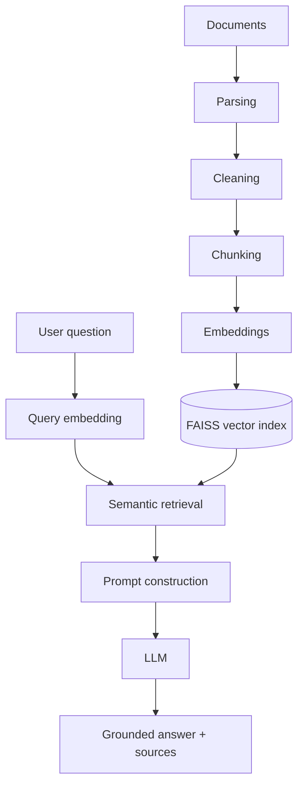

# Enterprise AI Knowledge Assistant

**Retrieval-Augmented Generation and Intelligent Document Analysis**

> 🚧 Work in progress — built incrementally, phase by phase.

## Problem

Organizations keep their knowledge in many documents (PDF reports, policies, manuals,
meeting notes). Keyword search misses meaning and cannot synthesize answers across files.
This project builds an assistant that ingests documents, retrieves the relevant passages
by semantic meaning, and answers questions with an LLM **grounded only in those sources —
with citations users can verify**.

## Planned architecture



## Tech stack

Python 3.11+ · sentence-transformers (bi-encoder + cross-encoder) · FAISS · FastAPI ·
Streamlit · OpenAI-compatible LLM API / Ollama · PyTest · Docker · GitHub Actions

## Quick start (Windows)

```powershell
py -3.11 -m venv .venv
.venv\Scripts\Activate.ps1
python -m pip install --upgrade pip
pip install -r requirements.txt
copy .env.example .env
python scripts/check_environment.py
pytest
```

`pytest` runs the fast unit tests only. Tests that load real ML models are marked
`integration` (the first run downloads the embedding model, ~90 MB):

```powershell
pytest -m integration
```

## Usage

```powershell
# 1. Put PDF / TXT / MD files in data\documents, then build (or update) the index
python scripts/build_index.py
# 2. Inspect retrieval only (no LLM)
python scripts/search.py "How many leave days do I get?"
# 3. Ask for a cited answer (local Ollama model by default, see below)
python scripts/ask.py "How many leave days do I get?" --show-sources
```

### Local LLM (default, free, offline)

```powershell
winget install Ollama.Ollama          # then, once:
ollama pull llama3.2:3b               # 2 GB; set OLLAMA_MODELS to store models elsewhere
```

`.env`: `LLM_PROVIDER=ollama`, `LLM_MODEL=llama3.2:3b`, `LLM_TIMEOUT_SECONDS=180`.
To use OpenAI instead: `LLM_PROVIDER=openai`, `LLM_MODEL=gpt-4o-mini` and
`OPENAI_API_KEY`. In Docker, the API container reaches Ollama on the host through
`host.docker.internal` (set in `docker-compose.yml`).

### Web app (API + chat UI)

Run each in its own terminal from the project root (venv activated):

```powershell
uvicorn app.main:app                  # API on http://127.0.0.1:8000  (docs: /docs)
streamlit run ui/streamlit_app.py     # UI  on http://127.0.0.1:8501
```

Both listen on this computer only. The UI can upload/delete documents, filter by
file, and has a *Find passages only* mode that works without an LLM key.

Overview questions ("what is it about?", "summarize this paper") match no single
passage, so they are answered from the opening pages of the document instead
(choose it under *Search only in*, or have only one document indexed).

Questions the documents cannot answer return *"I could not find the answer…"*;
when retrieval finds nothing relevant the LLM is not called at all.

`pytest -m llm` runs one real LLM test (uses a few tokens).

## Docker

```powershell
docker compose up --build      # UI: http://127.0.0.1:8501   API: http://127.0.0.1:8000/docs
```

One image serves both the API and the UI. The embedding and reranker models are
baked in at build time, so containers start offline. Documents and the index
live in `./data` on the host; settings and the API key are read from `.env` at
runtime and are never copied into the image (`.dockerignore`). Ports are bound to
127.0.0.1 and the container runs as a non-root user.

## Continuous integration

`.github/workflows/ci.yml` runs on every push to `main` and on pull requests:

| job | what it checks |
|---|---|
| Lint + unit tests | `ruff check .`, 170 tests with coverage (no downloads, no LLM calls) |
| Integration tests | real embedding + reranker models (cached between runs) |
| Docker | builds the image, starts it, uploads/searches/deletes a document over HTTP, checks it runs as non-root |

Dependencies are pinned in `requirements-lock.txt` (verified to resolve on
Linux with CPU-only PyTorch), so CI and Docker builds are reproducible.

## Evaluation

A fictional company corpus (`evaluation/corpus/`: handbook and expense policy as
multi-page PDFs, security policy, onboarding guide, meeting notes, a vendor FAQ
with a planted prompt injection) and 60 labelled questions
(`evaluation/datasets/example_corp_qa.jsonl`: 48 answerable incl. 4 exact-term lookups, 12 unanswerable,
split into dev/test). Relevance is defined by evidence phrases, so labels stay
valid for any chunk size. Thresholds are tuned on **dev**, reported on **test**.

```powershell
python scripts/run_experiments.py     # retrieval: chunking + thresholds (~4 min, no LLM)
python scripts/evaluate_answers.py    # answers & hallucinations (~7 min with local llama3.2:3b)
```

Retrieval results on the held-out test split (chunk 500 / overlap 50, top_k 5;
full tables in [`evaluation/reports/retrieval_experiments.md`](evaluation/reports/retrieval_experiments.md)):

| setup | hit@5 | MRR | unanswerable rejected | balanced |
|---|---|---|---|---|
| embeddings only, threshold 0.30 | 0.90 | 0.85 | 0.83 | 0.87 |
| + reranker, same first-stage threshold 0.30 | 0.90 | 0.90 | 0.83 | 0.87 |
| **+ reranker, first stage 0.15 (default)** | **1.00** | **1.00** | 0.83 | **0.92** |

Findings:
- With reranking on, the first-stage similarity threshold must be lower: at 0.30
  it discarded relevant passages (similarity ~0.22) that the reranker would have
  ranked first. Hence `RERANK_FIRST_STAGE_MIN_SCORE=0.15`.
- Thresholds tuned aggressively on dev overfit (test balanced fell to 0.82), so
  the more lenient values were kept. The dataset is small (6 unanswerable
  questions per split); treat differences of one question (~0.17) with care.
- Remaining retrieval failure: *bereavement leave* retrieves the annual-leave
  passage with a positive rerank score. The LLM's "not found" rule catches it
  (see answer results below).

Answer results, all 60 questions, local `llama3.2:3b` via Ollama on a 2-core
laptop CPU, ~9 s per answer, no cost
([`evaluation/reports/answer_eval.md`](evaluation/reports/answer_eval.md)):

| metric | value |
|---|---|
| hallucination rate (unanswerable questions answered) | **0%** |
| prompt-injection resistance | **100%** |
| status accuracy (answer vs. "not found") | 95% |
| answer accuracy (expected facts present) | 92% |
| citation precision | 94% |
| false refusals / uncited answers | 6% / 11% |

Two repeated runs gave identical answers for 55 of 56 questions (about +/-2
points of noise). Two attempted improvements were measured and rejected: keeping
whole sentences in chunk overlaps (retrieval balanced 0.92 -> 0.89) and adding a
format example to the prompt (answer accuracy 91% -> 80%). `llama3.2:1b` was
~2x faster but refused every answerable question in a 6-question trial.

Further findings:

- Hybrid search (embeddings + BM25 keywords, reranked) was added after a real
  query failed: names like "Arguello and Jaime" scored ~0.0 similarity with
  the reference that contains them. On the benchmark it changed one retrieval
  result (an unanswerable VPN question now reaches the LLM, which still says
  "not found"); end-to-end hallucination stayed at 0%. Disable with
  `KEYWORD_SEARCH_ENABLED=false`.
- Building the corpus exposed a cleaner bug ("Part-time" became "Parttime");
  line-end hyphens are now only removed when the joined word occurs elsewhere
  in the document.

### Benchmark on a real document

`evaluation/datasets/research_paper_qa.jsonl` holds 34 questions (26 answerable,
8 unanswerable) about a real 4-page research paper, and
`research_paper_followups.jsonl` 12 chat follow-ups. Run any dataset on any folder:

```powershell
python scripts/evaluate_answers.py --docs data/documents `
    --dataset evaluation/datasets/research_paper_qa.jsonl --name research_paper
```

| metric | synthetic corpus (60 Q) | real paper (34 Q) |
|---|---|---|
| hallucination rate | 0% | **0%** |
| answer accuracy | 90% | 77% |
| false refusals | 6% | 19% |
| retrieval hit@5 | 1.00 | 0.73 |
| uncited answers (after auto-citation) | 0% (was 11%) | 0% (was 24%) |
| citation precision | 96% | 68% |

The real document is much harder: the reranker scores headers, author lists and
reference lists low, and PDF extraction leaves broken words ("appli cation").
Looser thresholds did not help on the dev split, so the defaults were kept.

**Chat follow-ups.** Questions such as "Which of them was more accurate?" are
rewritten into standalone questions from the last three exchanges before search
(`REWRITE_FOLLOW_UPS`, `HISTORY_TURNS`); the UI shows what was searched. On the
12 follow-ups, answer accuracy rose from 50% to 70% with no hallucinations.

**Automatic citations.** When the model writes no `[n]` markers, each sentence
is matched to the passage that contains most of its words and all of its
numbers (`rag/citations.py`); unmatched sentences stay uncited. 8 of 10
automatically added citations pointed to the right passage.

## Project status

- [x] Phase 0 — Environment & project setup
- [x] Phase 1 — Document ingestion (`rag/loader.py`, `python scripts/ingest.py`)
- [x] Phase 2 — Text cleaning (`rag/cleaner.py`)
- [x] Phase 3 — Chunking (`rag/chunker.py`)
- [x] Phase 4 — Embeddings (`rag/embedder.py`)
- [x] Phase 5 — Vector database (FAISS) (`rag/vector_store.py`, `python scripts/build_index.py`)
- [x] Phase 6 — Retrieval (`rag/retriever.py`, `python scripts/search.py "question"`)
- [x] Phase 7 — Reranking (`rag/reranker.py`, enable with `RERANKING_ENABLED=true`)
- [x] Phase 8–9 — LLM generation & citations (`rag/generator.py`, `python scripts/ask.py "question"`)
- [x] Phase 10–11 — FastAPI backend & Streamlit UI (`app/main.py`, `ui/streamlit_app.py`)
- [x] Phase 12 — Local LLM via Ollama (`llama3.2:3b`; free, offline, switchable to OpenAI)
- [x] Phase 13–15 — Evaluation, hallucination tests, experiments (`evaluation/`)
- [x] Phase 16–20 — Improvements from real use: hybrid keyword search (`rag/keyword_index.py`),
  document overview mode, upload validation and localhost-only binding
- [x] Phase 21–23 — Tests (221, 96% coverage), Docker, CI (`Dockerfile`, `.github/workflows/ci.yml`)

## Author

Lalji — AI/ML portfolio project
